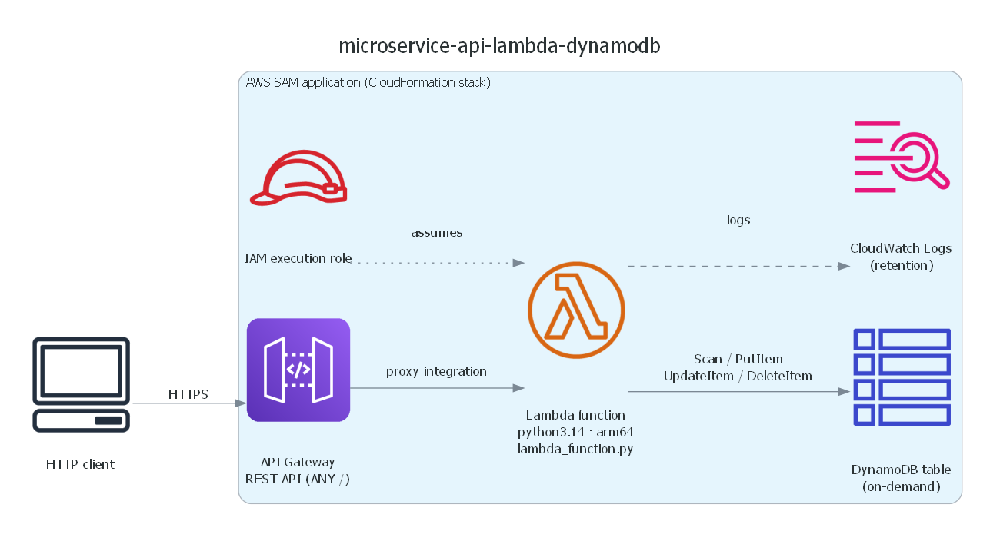

# Serverless microservice using API Gateway, Lambda, and DynamoDB



Start up:

- Deploy application, specifying table name

Test:

Get the endpoint from the `ApiUrl` stack output, then:

```
curl --location --request GET '<endpoint>'
curl --location --request POST '<endpoint>' 	--header 'Content-Type: application/json' 	--data-raw '{
		"Item": {
			"id": {
				"S": "test"
			}
		}
	}'
curl --location --request DELETE '<endpoint>' 	--header 'Content-Type: application/json' 	--data-raw '{
		"Key": {
			"id": {
				"S": "test"
			}
		}
	}'
```

A Postman collection is available in the [GitHub repo](https://github.com/bstraehle/aws-api-lambda-dynamodb).

Tear down:

- Go to CloudFormation and delete application stack (this also deletes the CloudWatch log group)
