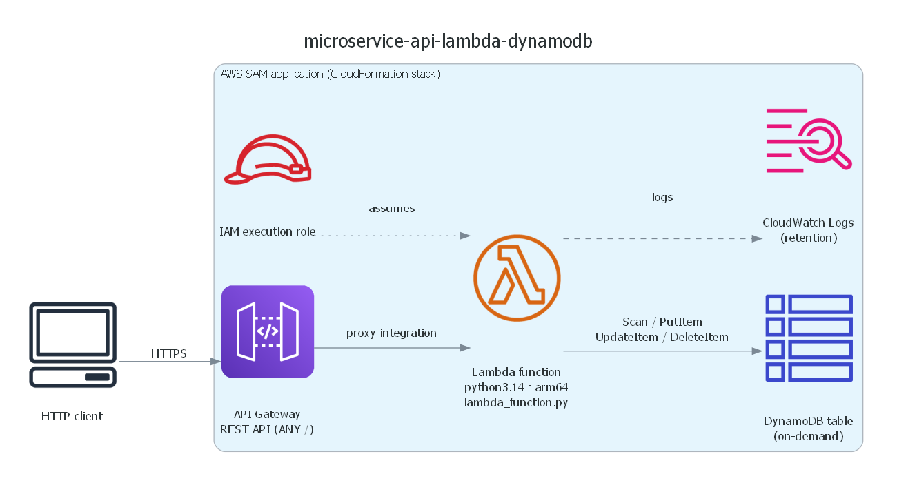
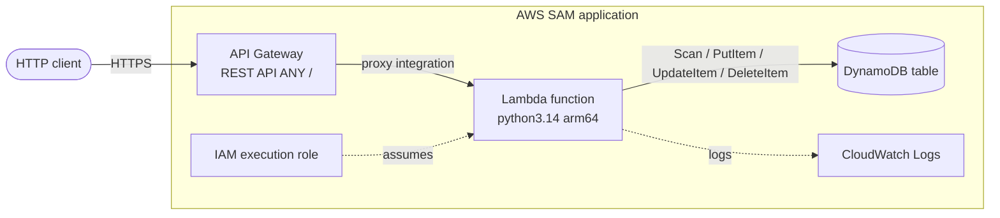

# Serverless microservice using API Gateway, Lambda, and DynamoDB

Available in the [AWS Serverless Application Repository](https://serverlessrepo.aws.amazon.com/applications/us-west-2/819097794827/microservice-api-lambda-dynamodb).

## Architecture





## Prerequisites

- [AWS CLI](https://docs.aws.amazon.com/cli/latest/userguide/getting-started-install.html)
- [AWS SAM CLI](https://docs.aws.amazon.com/serverless-application-model/latest/developerguide/install-sam-cli.html)

Clone repo:
```
git clone https://github.com/bstraehle/aws-api-lambda-dynamodb.git
cd aws-api-lambda-dynamodb
```

Validate template:
```
sam validate --lint
```

## Deploy directly

```
sam deploy --guided --capabilities CAPABILITY_IAM --parameter-overrides TableName=<table>
```

## Publish to the AWS Serverless Application Repository

Create S3 bucket:
```
aws s3 mb s3://<bucket>
```

Update policy.json and add account and bucket info

Allow the Serverless Application Repository to read from bucket:
```
aws s3api put-bucket-policy --bucket <bucket> --policy file://policy.json
```

Package application:
```
sam package --template-file template.yaml --output-template-file packaged.yaml --s3-bucket <bucket>
```

Publish application (bump `SemanticVersion` in template.yaml for each new version):
```
sam publish --template packaged.yaml --region <region>
```

Login to the AWS Console and deploy application

## Test

Get the endpoint from the `ApiUrl` stack output, then:

```
curl --location --request GET '<endpoint>'
curl --location --request POST '<endpoint>' 	--header 'Content-Type: application/json' 	--data-raw '{
		"Item": {
			"id": {
				"S": "test"
			}
		}
	}'
curl --location --request DELETE '<endpoint>' 	--header 'Content-Type: application/json' 	--data-raw '{
		"Key": {
			"id": {
				"S": "test"
			}
		}
	}'
```

A Postman collection is available in `aws-api-lambda-dynamodb.postman_collection.json`.

## Tear down

- Go to CloudFormation and delete application stack (this also deletes the CloudWatch log group)
- Go to S3 and empty and delete the packaging bucket, if no longer needed
